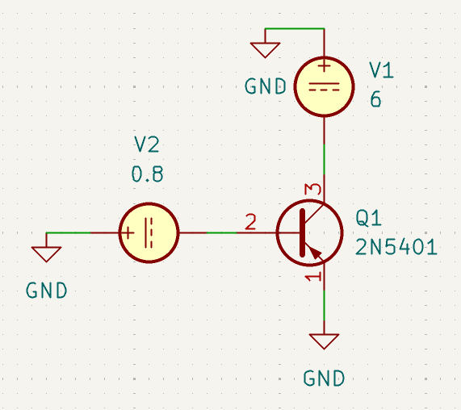
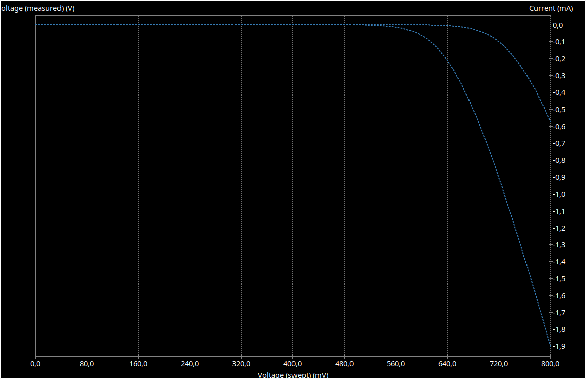
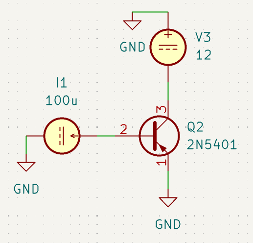
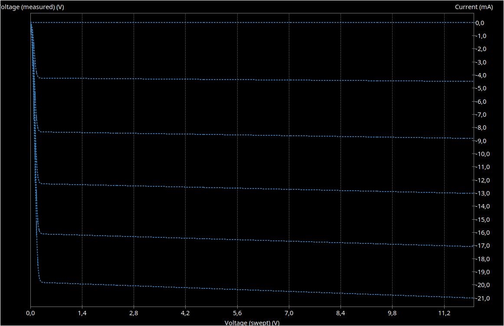
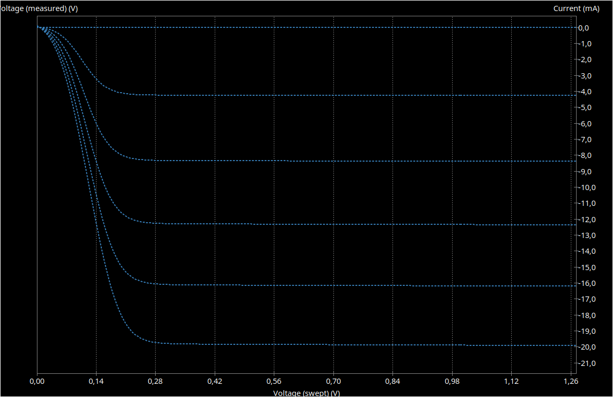
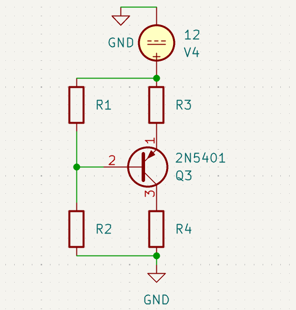
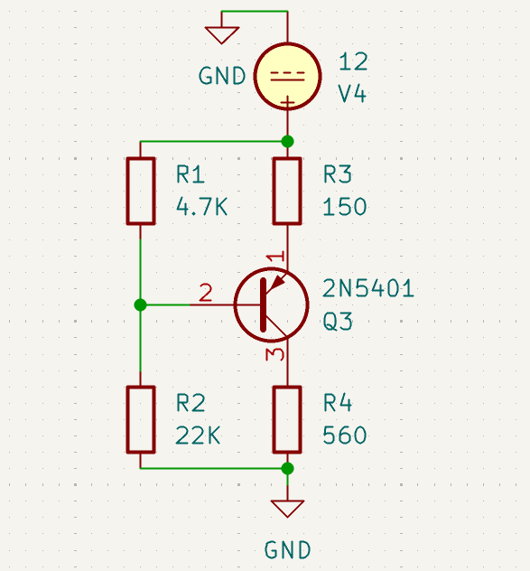
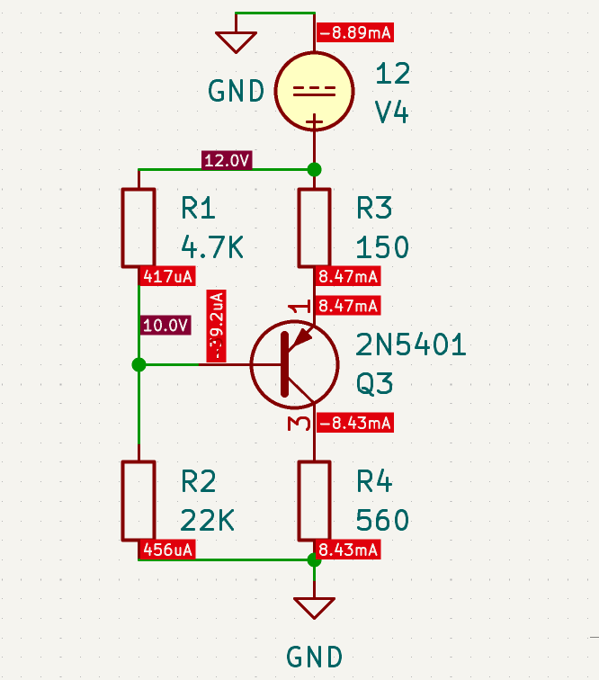

# Practical Task №1 — Calculation of Bias Networks for a Bipolar Transistor Stage

**Student:** Bohdan Zasymovych \
**Variant (list number $N$):** $6$

---

## 1. Initial Data

| Parameter | Value |
|---|---|
| $n_1$ | $6$ |
| $n_2$ | $12$ |
| Transistor | **2N5401** (PNP) |
| Supply voltage | $V_{CC} = n_2 = 12\ \text{V}$ |

---

## 2. Transistor Parameters

Datasheet values (Semtech 2N5401, $T_a = 25\ ^\circ\text{C}$) used in this work:

| Parameter | Symbol | Value |
|---|---|---|
| Collector–emitter voltage (max) | $-V_{CEO}$ | $150\ \text{V}$ |
| Collector current (max) | $-I_C$ | $600\ \text{mA}$ |
| Power dissipation (max) | $P_{tot}$ | $625\ \text{mW}$ |
| DC current gain ($-V_{CE} = 5\ \text{V}$, $-I_C = 10\ \text{mA}$) | $h_{FE}$ | $60 \ldots 240$ |
| Collector–emitter saturation voltage ($-I_C = 10\ \text{mA}$, $-I_B = 1\ \text{mA}$) | $-V_{CE(sat)}$ | $\le 0.2\ \text{V}$ |

Pinout (TO-92): 1 — Emitter, 2 — Base, 3 — Collector.

SPICE model: **2N5401C** (Cordell Audio), simulated in KiCad 9 (ngspice).

---

## 3. I–V Characteristics

The characteristics were simulated within the safe operating area:

$$
\lvert V_{CE}\rvert \le V_{CC} = 12\ \text{V} \ll 150\ \text{V}, \qquad
\lvert I_C\rvert \le 21\ \text{mA}, \qquad
P \le 12\ \text{V} \cdot 21\ \text{mA} \approx 0.25\ \text{W} < 625\ \text{mW}
$$

### 3.1 Input Characteristic

DC sweep of $V_{EB}$ from $0$ to $0.8\ \text{V}$ with a $5\ \text{mV}$ step, at $-V_{CE} = 0\ \text{V}$ and $-V_{CE} = 6\ \text{V}$.

*Fig. 1. Circuit for simulating the input characteristic*

*Fig. 2. Input characteristic $I_B = f(V_{EB})$. The left curve corresponds to $−V_{CE} = 0 \text{V}$, the right one to $−V_{CE} = 6 \text{V}$.*

The base current is negligible below about $0.55\ \text{V}$ and rises steeply between $0.6$ and $0.75\ \text{V}$.

### 3.2 Output Characteristics

DC sweep of $-V_{CE}$ from $0$ to $12\ \text{V}$ (step $5\ \text{mV}$), with base current $I_B = 0 \ldots 100\ \mu\text{A}$ (step $20\ \mu\text{A}$).

*Fig. 3. Circuit for simulating the output characteristics*

*Fig. 4. Output characteristics $I_C = f(V_{CE})$*

*Fig. 5. Output characteristics, saturation region (zoomed)*

| $I_B$, $\mu\text{A}$ | $20$ | $40$ | $60$ | $80$ | $100$ |
|---|---|---|---|---|---|
| $\lvert I_C\rvert$ at $-V_{CE} = 6\ \text{V}$, $\text{mA}$ | $\approx 4.3$ | $\approx 8.5$ | $\approx 12.5$ | $\approx 16.5$ | $\approx 20.5$ |

The saturation region ends at about $\lvert V_{CE}\rvert \approx 0.25 \ldots 0.3\ \text{V}$. In the active region the curves are almost flat. The current gain is $\beta \approx 205 \ldots 215$, which lies within the datasheet range $h_{FE} = 60 \ldots 240$.

---

## 4. Operating Point

| Parameter | Value | Justification |
|---|---|---|
| $V_{CE}$ | $V_{CC}/2 = 12/2 = 6\ \text{V}$ | Middle of the load line: maximum symmetric output swing |
| $I_C$ | $8.5\ \text{mA}$ | On the simulated $I_B = 40\ \mu\text{A}$ curve |
| $I_B$ | $40\ \mu\text{A}$ | From the output characteristics |
| $\beta$ | $I_C / I_B = 8.5\ \text{mA} / 40\ \mu\text{A} \approx 212$ | From the output characteristics |
| $V_{EB}$ | $0.69\ \text{V}$ | From the input characteristic |

Check against the limits:

$$
P = V_{CE} \cdot I_C = 6 \cdot 8.5\ \text{mA} = 51\ \text{mW} \ll 625\ \text{mW}, \qquad
V_{CE} = 6\ \text{V} \gg V_{CE(sat)} = 0.2\ \text{V}
$$

---

## 5. Calculation of Bias Resistors

*Fig. 6. Initial bias circuit of the PNP stage*

Roles of the resistors:

- $R_1$ — $V_{CC}$ → base (top of the divider)
- $R_2$ — base → GND (bottom of the divider)
- $R_3$ — $V_{CC}$ → emitter (emitter resistor)
- $R_4$ — collector → GND (collector resistor)

**$R_3$ (emitter resistor).** The voltage across $R_3$ is taken as $10\ \%$ of $V_{CC}$. This is a compromise between operating-point stability and output swing.

$$
V_{R3} = \frac{V_{CC}}{10} = \frac{12}{10} = 1.2\ \text{V}
$$

$$
I_E = I_B + I_C = 0.04\ \text{mA} + 8.5\ \text{mA} = 8.54\ \text{mA}, \qquad I_{R3} = I_E
$$

$$
R_3 = \frac{V_{R3}}{I_{R3}} = \frac{1.2}{0.00854} \approx 140.5\ \Omega \;\rightarrow\; 150\ \Omega\ (\text{E24})
$$

**$R_4$ (collector resistor).**

$$
V_{R4} = V_{CC} - V_{R3} - V_{CE} = 12 - 1.2 - 6 = 4.8\ \text{V}, \qquad I_{R4} = I_C = 8.5\ \text{mA}
$$

$$
R_4 = \frac{V_{R4}}{I_{R4}} = \frac{4.8}{0.0085} \approx 564.7\ \Omega \;\rightarrow\; 560\ \Omega\ (\text{E24})
$$

**Base voltage.**

$$
V_E = V_{CC} - V_{R3} = 12 - 1.2 = 10.8\ \text{V}, \qquad
V_B = V_E - V_{EB} = 10.8 - 0.69 = 10.11\ \text{V}
$$

**$R_1$.** The divider current is taken as $10\,I_B$.

$$
V_{R1} = V_{CC} - V_B = 12 - 10.11 = 1.89\ \text{V}, \qquad
I_{R1} = 10 \cdot I_B = 10 \cdot 0.00004 = 0.0004\ \text{A} = 400\ \mu\text{A}
$$

$$
R_1 = \frac{V_{R1}}{I_{R1}} = \frac{1.89}{0.0004} = 4725\ \Omega \;\rightarrow\; 4.7\ \text{k}\Omega\ (\text{E24})
$$

**$R_2$.**

$$
V_{R2} = V_{CC} - V_{R1} = 12 - 1.89 = 10.11\ \text{V}, \qquad
I_{R2} = I_{R1} + I_B = 0.0004 + 0.00004 = 0.00044\ \text{A}
$$

$$
R_2 = \frac{V_{R2}}{I_{R2}} = \frac{10.11}{0.00044} \approx 22.98\ \text{k}\Omega \;\rightarrow\; 22\ \text{k}\Omega\ (\text{E24})
$$

**Summary:**

| Resistor | Calculated | E24 |
|---|---|---|
| $R_1$ | $4725\ \Omega$ | $\mathbf{4.7\ k\Omega}$ |
| $R_2$ | $22.98\ \text{k}\Omega$ | $\mathbf{22\ k\Omega}$ |
| $R_3$ | $140.5\ \Omega$ | $\mathbf{150\ \Omega}$ |
| $R_4$ | $564.7\ \Omega$ | $\mathbf{560\ \Omega}$ |

---

## 6. DC Simulation

*Fig. 7. Bias circuit with the E24 resistor values ($V_{CC} = 12\ \text{V}$)*

*Fig. 8. DC operating point simulation results*

| Quantity | Chosen | Simulated |
|---|---|---|
| $\lvert I_C\rvert$ | $8.5\ \text{mA}$ | $\mathbf{8.431\ mA}$ |
| $\lvert I_B\rvert$ | $40\ \mu\text{A}$ | $\mathbf{39.19\ \mu A}$ |
| $V_E$ | $10.8\ \text{V}$ | $\mathbf{10.730\ V}$ |
| $V_B$ | $10.11\ \text{V}$ | $\mathbf{10.039\ V}$ |
| $V_C$ | $4.8\ \text{V}$ | $\mathbf{4.721\ V}$ |
| $V_{CE} = V_E - V_C$ | $6\ \text{V}$ | $\mathbf{6.008\ V}$ |
| $V_{EB} = V_E - V_B$ | $0.69\ \text{V}$ | $\mathbf{0.690\ V}$ |
| $\beta = I_C / I_B$ | $212$ | $\mathbf{215}$ |
| $P_Q$ | $51\ \text{mW}$ | $\mathbf{50.7\ mW}$ |

---

## 7. Error Calculation

$$
\delta = \frac{\lvert X_{sim} - X_{chosen}\rvert}{X_{chosen}} \cdot 100\%
$$

$$
\delta_{I_C} = \frac{\lvert 8.431 - 8.5\rvert}{8.5} \cdot 100\% = 0.81\%, \qquad
\delta_{V_{CE}} = \frac{\lvert 6.008 - 6\rvert}{6} \cdot 100\% = 0.14\%
$$

$$
\delta_{I_B} = \frac{\lvert 39.19 - 40\rvert}{40} \cdot 100\% = 2.0\%, \qquad
\delta_{V_{EB}} = \frac{\lvert 0.690 - 0.69\rvert}{0.69} \cdot 100\% \approx 0\%
$$

**Possible causes of the errors:**

1. Rounding of the resistor values to the standard E24 series.
2. $\beta$ and $V_{EB}$ were read from the graphs. At the actual operating point the model gives $\beta \approx 215$ instead of $212$.
3. Rounding of intermediate values during the calculations.

---

## 8. Conclusions

1. For variant $N = 6$ ($n_1 = 6$, $n_2 = 12$), the PNP transistor 2N5401 with supply voltage $V_{CC} = 12\ \text{V}$ was studied.
2. The input and output I–V characteristics were simulated in KiCad (ngspice) within the safe operating area. The model gives $\beta \approx 205 \ldots 215$ (datasheet: $60 \ldots 240$) and $V_{EB} \approx 0.69\ \text{V}$ at $I_C \approx 8.5\ \text{mA}$.
3. The operating point $I_C = 8.5\ \text{mA}$, $V_{CE} = 6\ \text{V}$ was chosen in the middle of the load line, which gives the maximum symmetric output swing. It dissipates $51\ \text{mW}$, far below $P_{tot} = 625\ \text{mW}$.
4. The bias resistors were calculated and rounded to the E24 series: $R_1 = 4.7\ \text{k}\Omega$, $R_2 = 22\ \text{k}\Omega$, $R_3 = 150\ \Omega$, $R_4 = 560\ \Omega$.
5. The DC simulation matches the chosen operating point: the error is $0.81\ \%$ for $I_C$ and $0.14\ \%$ for $V_{CE}$. The main sources of error are E24 rounding and approximate parameters read from the graphs.